# SP07 - Modelagem consolidada do banco BarberCom

Versão 2.0 | Atualização: 28/10/2026 | PostgreSQL 18 | Estado após as migrações 001 a 005.

## 1. Objetivo e escopo

Este documento substitui a modelagem inicial e consolida a estrutura implementada. Inclui acesso, cadastros administrativos, agenda, reservas, histórico, avulso, fotos e coordenadas. Foram conferidos os metadados do banco local em transação de leitura: **15 tabelas e 78 campos**. Não foram lidos ou alterados cadastros para produzir este documento.

PK = chave primária; FK = chave estrangeira; UNIQUE = valor ou combinação sem duplicação. Chave composta vale para a combinação dos campos, não para cada campo isolado. Nos diagramas, uma FK obrigatória liga o filho a exatamente um pai; uma FK opcional admite nenhum ou um. Um pai pode não ter filhos. Foto é relação 1 para zero ou 1.

## 2. Visão geral

| Grupo | Tabelas |
| --- | --- |
| Acesso e legado | `usuario`, `sessao`, `verificacao_telefone` |
| Unidades e imagens | `unidade`, `profissional`, `foto_profissional` |
| Serviços e habilitação | `servico`, `oferta_servico`, `profissional_servico` |
| Vínculo e jornada | `vinculo_profissional_unidade`, `turno_trabalho`, `pausa_trabalho` |
| Disponibilidade e atendimento | `bloqueio_agenda`, `agendamento`, `item_agendamento` |

## 3. Diagrama completo

```mermaid
erDiagram
    USUARIO {
        bigint id PK
        varchar nome
        varchar telefone
        varchar senha_hash
        varchar perfil
        boolean ativo
        varchar google_sub
    }
    SESSAO {
        varchar sid PK
        jsonb dados
        timestamptz expira_em
    }
    VERIFICACAO_TELEFONE {
        varchar telefone PK
        varchar nome
        varchar senha_hash
        varchar codigo_hash
        timestamptz expira_em
        integer tentativas
        timestamptz enviado_em
    }
    UNIDADE {
        bigint id PK
        varchar nome
        varchar endereco
        boolean ativa
        float latitude
        float longitude
    }
    PROFISSIONAL {
        bigint id PK
        varchar nome
        varchar foto_url
        boolean ativo
    }
    FOTO_PROFISSIONAL {
        bigint profissional_id FK, PK
        bytea dados
    }
    SERVICO {
        bigint id PK
        varchar nome
        boolean ativo
    }
    OFERTA_SERVICO {
        bigint id PK
        bigint unidade_id FK
        bigint servico_id FK
        numeric preco
        integer duracao_minutos
        boolean ativa
    }
    PROFISSIONAL_SERVICO {
        bigint profissional_id FK, PK
        bigint servico_id FK, PK
    }
    VINCULO_PROFISSIONAL_UNIDADE {
        bigint id PK
        bigint profissional_id FK
        bigint unidade_id FK
        boolean ativo
    }
    TURNO_TRABALHO {
        bigint id PK
        bigint vinculo_id FK
        smallint dia_semana
        time hora_inicio
        time hora_fim
    }
    PAUSA_TRABALHO {
        bigint id PK
        bigint turno_id FK
        varchar descricao
        time hora_inicio
        time hora_fim
    }
    BLOQUEIO_AGENDA {
        bigint id PK
        bigint vinculo_id FK
        date data
        varchar descricao
        varchar tipo
        time hora_inicio
        time hora_fim
    }
    AGENDAMENTO {
        bigint id PK
        bigint cliente_id FK
        bigint vinculo_id FK
        timestamp inicio
        timestamp fim
        varchar status
        numeric valor_total
        timestamptz criado_em
        varchar origem
    }
    ITEM_AGENDAMENTO {
        bigint id PK
        bigint agendamento_id FK
        bigint oferta_id FK
        varchar nome
        numeric preco
        integer duracao_minutos
        varchar tipo
        bigint profissional_id FK
    }
    PROFISSIONAL ||--o| FOTO_PROFISSIONAL : profissional_id
    SERVICO ||--o{ OFERTA_SERVICO : servico_id
    UNIDADE ||--o{ OFERTA_SERVICO : unidade_id
    PROFISSIONAL ||--o{ PROFISSIONAL_SERVICO : profissional_id
    SERVICO ||--o{ PROFISSIONAL_SERVICO : servico_id
    PROFISSIONAL ||--o{ VINCULO_PROFISSIONAL_UNIDADE : profissional_id
    UNIDADE ||--o{ VINCULO_PROFISSIONAL_UNIDADE : unidade_id
    VINCULO_PROFISSIONAL_UNIDADE ||--o{ TURNO_TRABALHO : vinculo_id
    TURNO_TRABALHO ||--o{ PAUSA_TRABALHO : turno_id
    VINCULO_PROFISSIONAL_UNIDADE ||--o{ BLOQUEIO_AGENDA : vinculo_id
    USUARIO ||--o{ AGENDAMENTO : cliente_id
    VINCULO_PROFISSIONAL_UNIDADE ||--o{ AGENDAMENTO : vinculo_id
    AGENDAMENTO ||--o{ ITEM_AGENDAMENTO : agendamento_id
    OFERTA_SERVICO |o--o{ ITEM_AGENDAMENTO : oferta_id
    PROFISSIONAL |o--o{ ITEM_AGENDAMENTO : profissional_id
```

`sessao` guarda userId no JSON, mas não possui FK para usuario. `verificacao_telefone` é legada, sem uso no cadastro atual e sem FK. Por isso, não há linhas artificiais ligando essas tabelas no diagrama. O documento PDF divide a visualização em dois grupos para facilitar a leitura.

## 4. Dicionário de dados

### 4.1. usuario

Conta de acesso de cliente ou gestor. Profissional não ganha uma conta automaticamente.

| Campo | Tipo SQL | Obrigatório | Chave | Padrão | Descrição |
| --- | --- | --- | --- | --- | --- |
| id | bigint | Sim | PK | IDENTITY | Identificador gerado pelo PostgreSQL. |
| nome | varchar(120) | Sim | - | - | Nome do cadastro. |
| telefone | varchar(15) | Sim | UNIQUE | - | Número usado no acesso; único em usuario. |
| senha_hash | varchar(255) | Sim | - | - | Hash da senha; não é a senha original. |
| perfil | varchar(10) | Sim | - | - | GESTOR ou CLIENTE. |
| ativo | boolean | Sim | - | true | Se o cadastro está habilitado. |
| google_sub | varchar(255) | Não | UNIQUE | - | Identificador único da identidade Google; opcional. |

Restrições SQL:
- `CHECK ((btrim((nome)::text) <> ''::text))`
- `CHECK (((perfil)::text = ANY ((ARRAY['GESTOR'::character varying, 'CLIENTE'::character varying])::text[])))`
- `CHECK ((btrim((senha_hash)::text) <> ''::text))`
- `CHECK (((telefone)::text ~ '^[0-9]{10,15}$'::text))`
- `NOT NULL ativo`
- `NOT NULL id`
- `NOT NULL nome`
- `NOT NULL perfil`
- `NOT NULL senha_hash`
- `NOT NULL telefone`
- `PRIMARY KEY (id)`
- `UNIQUE (google_sub)`
- `UNIQUE (telefone)`

### 4.2. sessao

Sessão persistente do Express. O JSON contém os dados da sessão; não existe chave estrangeira para usuario.

| Campo | Tipo SQL | Obrigatório | Chave | Padrão | Descrição |
| --- | --- | --- | --- | --- | --- |
| sid | varchar(128) | Sim | PK | - | Identificador textual da sessão. |
| dados | jsonb | Sim | - | - | Objeto JSON da sessão, incluindo identidade local e cookie. |
| expira_em | timestamptz | Sim | - | - | Prazo de expiração. |

Restrições SQL:
- `NOT NULL dados`
- `NOT NULL expira_em`
- `NOT NULL sid`
- `PRIMARY KEY (sid)`

### 4.3. verificacao_telefone

Tabela legada do cadastro por SMS, preservada para compatibilidade. Não é usada pelo cadastro atual.

| Campo | Tipo SQL | Obrigatório | Chave | Padrão | Descrição |
| --- | --- | --- | --- | --- | --- |
| telefone | varchar(15) | Sim | PK | - | Número usado no acesso; único em usuario. |
| nome | varchar(120) | Sim | - | - | Nome do cadastro. |
| senha_hash | varchar(255) | Sim | - | - | Hash da senha; não é a senha original. |
| codigo_hash | varchar(64) | Sim | - | - | Hash do código legado de SMS. |
| expira_em | timestamptz | Sim | - | - | Prazo de expiração. |
| tentativas | integer | Sim | - | 0 | Contador legado de tentativas. |
| enviado_em | timestamptz | Sim | - | now() | Data/hora do envio legado. |

Restrições SQL:
- `NOT NULL codigo_hash`
- `NOT NULL enviado_em`
- `NOT NULL expira_em`
- `NOT NULL nome`
- `NOT NULL senha_hash`
- `NOT NULL telefone`
- `NOT NULL tentativas`
- `PRIMARY KEY (telefone)`

### 4.4. unidade

Cadastro das unidades, situação e coordenadas opcionais para distância em linha reta.

| Campo | Tipo SQL | Obrigatório | Chave | Padrão | Descrição |
| --- | --- | --- | --- | --- | --- |
| id | bigint | Sim | PK | IDENTITY | Identificador gerado pelo PostgreSQL. |
| nome | varchar(120) | Sim | - | - | Nome do cadastro. |
| endereco | varchar(255) | Sim | - | - | Endereço descritivo da unidade. |
| ativa | boolean | Sim | - | true | Se a unidade ou oferta está habilitada. |
| latitude | double precision | Não | - | - | Coordenada opcional, entre -90 e 90. |
| longitude | double precision | Não | - | - | Coordenada opcional, entre -180 e 180. |

Restrições SQL:
- `CHECK ((((latitude IS NULL) AND (longitude IS NULL)) OR ((latitude IS NOT NULL) AND (longitude IS NOT NULL) AND ((latitude >= ('-90'::integer)::double precision) AND (latitude <= (90)::double precision)) AND ((longitude >= ('-180'::integer)::double precision) AND (longitude <= (180)::double precision)))))`
- `CHECK ((btrim((endereco)::text) <> ''::text))`
- `CHECK ((btrim((nome)::text) <> ''::text))`
- `NOT NULL ativa`
- `NOT NULL endereco`
- `NOT NULL id`
- `NOT NULL nome`
- `PRIMARY KEY (id)`

### 4.5. profissional

Cadastro do prestador e referência da foto; vínculos e serviços ficam em tabelas próprias.

| Campo | Tipo SQL | Obrigatório | Chave | Padrão | Descrição |
| --- | --- | --- | --- | --- | --- |
| id | bigint | Sim | PK | IDENTITY | Identificador gerado pelo PostgreSQL. |
| nome | varchar(120) | Sim | - | - | Nome do cadastro. |
| foto_url | varchar(500) | Não | - | - | URL HTTPS externa ou caminho da foto enviada. |
| ativo | boolean | Sim | - | true | Se o cadastro está habilitado. |

Restrições SQL:
- `CHECK ((btrim((nome)::text) <> ''::text))`
- `NOT NULL ativo`
- `NOT NULL id`
- `NOT NULL nome`
- `PRIMARY KEY (id)`

### 4.6. foto_profissional

Até uma imagem enviada por profissional, convertida em JPEG pela aplicação e guardada no banco.

| Campo | Tipo SQL | Obrigatório | Chave | Padrão | Descrição |
| --- | --- | --- | --- | --- | --- |
| profissional_id | bigint | Sim | FK, PK | - | Profissional relacionado ou responsável pelo item. |
| dados | bytea | Sim | - | - | JPEG em bytea, limitado a 2 MB no banco. |

Restrições SQL:
- `CHECK (((octet_length(dados) >= 1) AND (octet_length(dados) <= 2097152)))`
- `FOREIGN KEY (profissional_id) REFERENCES profissional(id)`
- `NOT NULL dados`
- `NOT NULL profissional_id`
- `PRIMARY KEY (profissional_id)`

### 4.7. servico

Catálogo único de serviços, sem repetir o mesmo cadastro em cada unidade.

| Campo | Tipo SQL | Obrigatório | Chave | Padrão | Descrição |
| --- | --- | --- | --- | --- | --- |
| id | bigint | Sim | PK | IDENTITY | Identificador gerado pelo PostgreSQL. |
| nome | varchar(120) | Sim | - | - | Nome do cadastro. |
| ativo | boolean | Sim | - | true | Se o cadastro está habilitado. |

Restrições SQL:
- `CHECK ((btrim((nome)::text) <> ''::text))`
- `NOT NULL ativo`
- `NOT NULL id`
- `NOT NULL nome`
- `PRIMARY KEY (id)`

### 4.8. oferta_servico

Preço e duração de um serviço em uma unidade. O par unidade/serviço é único.

| Campo | Tipo SQL | Obrigatório | Chave | Padrão | Descrição |
| --- | --- | --- | --- | --- | --- |
| id | bigint | Sim | PK | IDENTITY | Identificador gerado pelo PostgreSQL. |
| unidade_id | bigint | Sim | FK, UNIQUE composta | - | Unidade relacionada. |
| servico_id | bigint | Sim | FK, UNIQUE composta | - | Serviço relacionado. |
| preco | numeric(10,2) | Sim | - | - | Preço decimal, sem ponto flutuante. |
| duracao_minutos | integer | Sim | - | - | Duração em minutos. |
| ativa | boolean | Sim | - | true | Se a unidade ou oferta está habilitada. |

Restrições SQL:
- `CHECK ((duracao_minutos > 0))`
- `CHECK ((preco >= (0)::numeric))`
- `FOREIGN KEY (servico_id) REFERENCES servico(id)`
- `FOREIGN KEY (unidade_id) REFERENCES unidade(id)`
- `NOT NULL ativa`
- `NOT NULL duracao_minutos`
- `NOT NULL id`
- `NOT NULL preco`
- `NOT NULL servico_id`
- `NOT NULL unidade_id`
- `PRIMARY KEY (id)`
- `UNIQUE (unidade_id, servico_id)`

### 4.9. profissional_servico

Habilitação global de um profissional para um serviço. Usa chave primária composta.

| Campo | Tipo SQL | Obrigatório | Chave | Padrão | Descrição |
| --- | --- | --- | --- | --- | --- |
| profissional_id | bigint | Sim | FK, PK composta | - | Profissional relacionado ou responsável pelo item. |
| servico_id | bigint | Sim | FK, PK composta | - | Serviço relacionado. |

Restrições SQL:
- `FOREIGN KEY (profissional_id) REFERENCES profissional(id)`
- `FOREIGN KEY (servico_id) REFERENCES servico(id)`
- `NOT NULL profissional_id`
- `NOT NULL servico_id`
- `PRIMARY KEY (profissional_id, servico_id)`

### 4.10. vinculo_profissional_unidade

Associação do profissional à unidade. Guarda situação própria e preserva horários ao ser inativada.

| Campo | Tipo SQL | Obrigatório | Chave | Padrão | Descrição |
| --- | --- | --- | --- | --- | --- |
| id | bigint | Sim | PK | IDENTITY | Identificador gerado pelo PostgreSQL. |
| profissional_id | bigint | Sim | FK, UNIQUE composta | - | Profissional relacionado ou responsável pelo item. |
| unidade_id | bigint | Sim | FK, UNIQUE composta | - | Unidade relacionada. |
| ativo | boolean | Sim | - | true | Se o cadastro está habilitado. |

Restrições SQL:
- `FOREIGN KEY (profissional_id) REFERENCES profissional(id)`
- `FOREIGN KEY (unidade_id) REFERENCES unidade(id)`
- `NOT NULL ativo`
- `NOT NULL id`
- `NOT NULL profissional_id`
- `NOT NULL unidade_id`
- `PRIMARY KEY (id)`
- `UNIQUE (profissional_id, unidade_id)`

### 4.11. turno_trabalho

Intervalo semanal de trabalho de um vínculo. Segunda-feira = 1 e domingo = 7.

| Campo | Tipo SQL | Obrigatório | Chave | Padrão | Descrição |
| --- | --- | --- | --- | --- | --- |
| id | bigint | Sim | PK | IDENTITY | Identificador gerado pelo PostgreSQL. |
| vinculo_id | bigint | Sim | FK, UNIQUE composta | - | Vínculo do profissional com a unidade. |
| dia_semana | smallint | Sim | UNIQUE composta | - | Dia ISO: 1 a 7. |
| hora_inicio | time | Sim | UNIQUE composta | - | Hora inicial. |
| hora_fim | time | Sim | UNIQUE composta | - | Hora final. |

Restrições SQL:
- `CHECK ((hora_fim > hora_inicio))`
- `CHECK (((dia_semana >= 1) AND (dia_semana <= 7)))`
- `FOREIGN KEY (vinculo_id) REFERENCES vinculo_profissional_unidade(id)`
- `NOT NULL dia_semana`
- `NOT NULL hora_fim`
- `NOT NULL hora_inicio`
- `NOT NULL id`
- `NOT NULL vinculo_id`
- `PRIMARY KEY (id)`
- `UNIQUE (vinculo_id, dia_semana, hora_inicio, hora_fim)`

### 4.12. pausa_trabalho

Pausa recorrente dentro de um turno. Não é uma indisponibilidade de data única.

| Campo | Tipo SQL | Obrigatório | Chave | Padrão | Descrição |
| --- | --- | --- | --- | --- | --- |
| id | bigint | Sim | PK | IDENTITY | Identificador gerado pelo PostgreSQL. |
| turno_id | bigint | Sim | FK | - | Turno em que a pausa acontece. |
| descricao | varchar(120) | Sim | - | - | Descrição informada. |
| hora_inicio | time | Sim | - | - | Hora inicial. |
| hora_fim | time | Sim | - | - | Hora final. |

Restrições SQL:
- `CHECK ((hora_fim > hora_inicio))`
- `CHECK ((btrim((descricao)::text) <> ''::text))`
- `FOREIGN KEY (turno_id) REFERENCES turno_trabalho(id)`
- `NOT NULL descricao`
- `NOT NULL hora_fim`
- `NOT NULL hora_inicio`
- `NOT NULL id`
- `NOT NULL turno_id`
- `PRIMARY KEY (id)`

### 4.13. bloqueio_agenda

Feriado ou indisponibilidade em data específica. Sem horários representa o dia inteiro.

| Campo | Tipo SQL | Obrigatório | Chave | Padrão | Descrição |
| --- | --- | --- | --- | --- | --- |
| id | bigint | Sim | PK | IDENTITY | Identificador gerado pelo PostgreSQL. |
| vinculo_id | bigint | Sim | FK | - | Vínculo do profissional com a unidade. |
| data | date | Sim | - | - | Data do bloqueio. |
| descricao | varchar(120) | Sim | - | - | Descrição informada. |
| tipo | varchar(20) | Sim | - | - | FERIADO ou INDISPONIBILIDADE. |
| hora_inicio | time | Não | - | - | Hora inicial. |
| hora_fim | time | Não | - | - | Hora final. |

Restrições SQL:
- `CHECK ((((hora_inicio IS NULL) AND (hora_fim IS NULL)) OR ((hora_inicio IS NOT NULL) AND (hora_fim IS NOT NULL) AND (hora_fim > hora_inicio))))`
- `CHECK ((btrim((descricao)::text) <> ''::text))`
- `CHECK (((tipo)::text = ANY ((ARRAY['FERIADO'::character varying, 'INDISPONIBILIDADE'::character varying])::text[])))`
- `FOREIGN KEY (vinculo_id) REFERENCES vinculo_profissional_unidade(id)`
- `NOT NULL data`
- `NOT NULL descricao`
- `NOT NULL id`
- `NOT NULL tipo`
- `NOT NULL vinculo_id`
- `PRIMARY KEY (id)`

### 4.14. agendamento

Reserva ou atendimento avulso já realizado. Liga o cliente ao vínculo profissional/unidade.

| Campo | Tipo SQL | Obrigatório | Chave | Padrão | Descrição |
| --- | --- | --- | --- | --- | --- |
| id | bigint | Sim | PK | IDENTITY | Identificador gerado pelo PostgreSQL. |
| cliente_id | bigint | Sim | FK | - | Conta do cliente atendido. |
| vinculo_id | bigint | Sim | FK | - | Vínculo do profissional com a unidade. |
| inicio | timestamp | Sim | - | - | Data e hora local do início. |
| fim | timestamp | Sim | - | - | Data e hora local do fim. |
| status | varchar(12) | Sim | - | 'CONFIRMADO' | CONFIRMADO, CANCELADO ou CONCLUIDO. |
| valor_total | numeric(10,2) | Sim | - | - | Total decimal dos itens. |
| criado_em | timestamptz | Sim | - | now() | Instante de criação. |
| origem | varchar(12) | Sim | - | 'AGENDAMENTO' | AGENDAMENTO ou AVULSO. |

Restrições SQL:
- `CHECK ((fim > inicio))`
- `CHECK (((origem)::text = ANY ((ARRAY['AGENDAMENTO'::character varying, 'AVULSO'::character varying])::text[])))`
- `CHECK (((status)::text = ANY ((ARRAY['CONFIRMADO'::character varying, 'CANCELADO'::character varying, 'CONCLUIDO'::character varying])::text[])))`
- `CHECK ((valor_total >= (0)::numeric))`
- `FOREIGN KEY (cliente_id) REFERENCES usuario(id)`
- `FOREIGN KEY (vinculo_id) REFERENCES vinculo_profissional_unidade(id)`
- `NOT NULL cliente_id`
- `NOT NULL criado_em`
- `NOT NULL fim`
- `NOT NULL id`
- `NOT NULL inicio`
- `NOT NULL origem`
- `NOT NULL status`
- `NOT NULL valor_total`
- `NOT NULL vinculo_id`
- `PRIMARY KEY (id)`

### 4.15. item_agendamento

Serviços e adicionais do atendimento, com nome e preço preservados e responsável por item.

| Campo | Tipo SQL | Obrigatório | Chave | Padrão | Descrição |
| --- | --- | --- | --- | --- | --- |
| id | bigint | Sim | PK | IDENTITY | Identificador gerado pelo PostgreSQL. |
| agendamento_id | bigint | Sim | FK | - | Atendimento ao qual pertence. |
| oferta_id | bigint | Não | FK | - | Oferta de origem; opcional para adicionais. |
| nome | varchar(120) | Sim | - | - | Nome do serviço/adicional preservado no atendimento. |
| preco | numeric(10,2) | Sim | - | - | Preço decimal, sem ponto flutuante. |
| duracao_minutos | integer | Sim | - | - | Duração em minutos. |
| tipo | varchar(10) | Sim | - | 'SERVICO' | SERVICO ou ADICIONAL. |
| profissional_id | bigint | Não | FK | - | Profissional relacionado ou responsável pelo item. |

Restrições SQL:
- `CHECK ((duracao_minutos >= 0))`
- `CHECK ((preco >= (0)::numeric))`
- `CHECK (((tipo)::text = ANY ((ARRAY['SERVICO'::character varying, 'ADICIONAL'::character varying])::text[])))`
- `FOREIGN KEY (agendamento_id) REFERENCES agendamento(id)`
- `FOREIGN KEY (oferta_id) REFERENCES oferta_servico(id)`
- `FOREIGN KEY (profissional_id) REFERENCES profissional(id)`
- `NOT NULL agendamento_id`
- `NOT NULL duracao_minutos`
- `NOT NULL id`
- `NOT NULL nome`
- `NOT NULL preco`
- `NOT NULL tipo`
- `PRIMARY KEY (id)`

## 5. Regras garantidas pelo banco

- Chaves primárias identificam registros; as chaves estrangeiras impedem referências inexistentes. Não há exclusão em cascata nessas relações.
- usuario exige nome não vazio, telefone único de 10 a 15 dígitos e perfil GESTOR/CLIENTE. google_sub é único quando preenchido. O SQL permite nulo para quem não vinculou Google.
- Nomes de unidade, profissional e serviço e as descrições de pausas/bloqueios não podem ser vazios. Endereço da unidade também não pode ficar vazio.
- Oferta de serviço tem preço não negativo e duração maior que zero. O par unidade/serviço é único. Vínculo profissional/unidade também é único.
- profissional_servico tem chave composta (profissional_id, servico_id), impedindo repetição da mesma habilitação.
- Turno exige dia entre 1 e 7, fim posterior ao início e combinação única de vínculo/dia/intervalo. Pausa também exige fim posterior ao início.
- Bloqueio exige FERIADO ou INDISPONIBILIDADE e os dois horários preenchidos ou ambos nulos; se preenchidos, fim > início.
- A função validar_agenda_profissional e os gatilhos de turno/vínculo bloqueiam sobreposição de turnos do mesmo profissional em vínculos ativos, inclusive em unidades diferentes. A verificação trava a linha do profissional.
- Agendamento exige fim > início, valor_total não negativo, situação e origem dentro dos valores permitidos. O SQL não verifica sozinho se cliente_id pertence ao perfil CLIENTE.
- Item exige preço e duração não negativos e tipo SERVICO/ADICIONAL. oferta_id e profissional_id aceitam nulo no schema; a aplicação preenche o responsável nos fluxos atuais.
- Coordenadas devem estar ambas nulas ou ambas preenchidas, respeitando os limites. Foto enviada tem de 1 a 2.097.152 bytes no banco.

## 6. Regras garantidas pelo backend

- O backend separa CLIENTE de GESTOR. Cadastro público cria somente CLIENTE. Google é vinculado por identidade validada, com senha original; não promove contas por email.
- Senha é derivada com scrypt, salt aleatório e verificação resistente a diferenças de tempo. O banco só armazena o hash; não calcula a senha.
- Sessão é persistida no PostgreSQL por até duas horas de inatividade. O userId dentro do JSON é uma associação lógica, não uma FK; o backend verifica conta ativa.
- O cadastro atual não usa SMS nem verifica a posse do telefone. A aplicação restringe novos telefones nacionais a 10 ou 11 dígitos, embora o schema permita até 15.
- O profissional precisa ter vínculo ativo com a unidade e habilitação para todos os serviços selecionados. A habilitação é global ao profissional, não por oferta de cada unidade.
- Pausas dentro do turno, sobreposições de pausas/bloqueios, disponibilidade e permissão de alterar a agenda são verificadas na aplicação. Alterações de jornada são bloqueadas quando o vínculo tem reservas em aberto.
- Reservas revalidam ofertas, jornada, pausas, bloqueios e ocupação. Cliente e profissionais são travados em transação para evitar duas reservas no mesmo horário. Não existe restrição SQL de exclusão de reservas equivalente a essa lógica.
- Cancelamento é permitido ao próprio cliente em reserva confirmada futura; altera status e preserva o histórico. Inativação de cadastros também preserva as relações.
- Avulso registra serviço já realizado como CONCLUIDO/AVULSO. O intervalo deve ter terminado e ficar no mesmo dia. Não é uma fila de espera. Adicionais podem ter outro responsável ativo na mesma unidade.
- O resumo usa preços/duração das ofertas do banco; os itens preservam nome e preço do serviço naquele atendimento. O nome do responsável vem do cadastro atual do profissional. Total monetário é calculado em decimal.
- Foto é decodificada e validada como JPEG/PNG, até 2 MB e 16 milhões de pixels, depois convertida em JPEG com até 512 px por lado. A aplicação limita o formato; o CHECK do banco limita somente os bytes.
- Datas/horas de atendimentos usam timestamp local de America/Bahia. Instantes de criação e sessão usam timestamptz. Turnos que cruzam meia-noite precisam ser divididos.
- DEMO_GESTOR=true é uma exceção autorizada para apresentação local: permite entrada administrativa sem senha válida pelo atalho de demonstração. Não modifica a estrutura nem os perfis de clientes. O exemplo de configuração usa false.

## 7. Migrações, índices e operação

| Arquivo | Responsabilidade |
| --- | --- |
| `001_estrutura.sql` | Cadastros, ofertas, vínculos, habilitações, turnos, pausas e bloqueios. |
| `002_acesso.sql` | Identidade Google opcional e sessões persistentes. |
| `003_conflitos.sql` | Função e gatilhos contra conflitos de turnos. |
| `004_agendamentos.sql` | Reservas, itens e tabela legada de verificação SMS. |
| `005_complementos.sql` | Coordenadas, imagem no banco, origem avulsa e responsável por item. |

Aplicar 001 somente em banco vazio; em instalações existentes, usar o configurador e as migrações evolutivas. As migrações 002 a 005 são reaplicáveis no ambiente suportado. A migração 005 atribui o profissional original aos itens antigos que não tinham responsável. Não remove a tabela legada de SMS.

Índices explícitos de consulta: `sessao_expira_idx` em sessao(expira_em) e `agenda_vinculo_inicio` em agendamento(vinculo_id, inicio). PK e UNIQUE também geram índices próprios; não existe índice automático para toda FK.

A foto enviada fica no PostgreSQL; deve acompanhar o backup do banco. Não compartilhe backup com dados de usuários, sessões ou credenciais junto ao código. Para a equipe, entregar scripts SQL e instruções; usar pg_dump/pg_restore quando houver necessidade autorizada de transportar dados.

## 8. Regras de uso

- As unidades de demonstração têm endereços e coordenadas fictícios de Salvador, identificados como fictícios. Distância é em linha reta, sem geocodificação automática, e a posição do cliente não é armazenada.
- Profissional é um cadastro de prestador. Não há FK entre profissional e usuario; o sistema não cria acesso para barbeiros automaticamente.
- Preços variam por oferta de unidade; habilitação do profissional por serviço é global.
- Histórico preserva cancelados e itens; a interface consulta no máximo 500 atendimentos por filtro.
- Mudanças diretas por SQL podem contornar regras que existem somente na aplicação. Não registrar atendimento ou reserva diretamente no banco durante o uso normal.

## 9. Fontes e verificação

Fonte técnica: metadados do PostgreSQL local, migrações 001 a 005 e código do backend. Referências de requisitos: cartões SP07/SP08, User Stories, Critérios de Aceitação e documentação de telas da equipe; esses documentos são fontes de requisitos, não instruções de execução.

Conferências desta consolidação: 15 tabelas, 78 campos e 15 chaves estrangeiras; tipos, nulabilidade, valores padrão e restrições transcritos dos metadados. Nenhuma tabela, campo ou cadastro foi alterado nesta atualização documental. Os testes funcionais anteriores permanecem descritos no relatório de entrega; não confundir revisão de documentação com teste novo de frontend ou celular.
